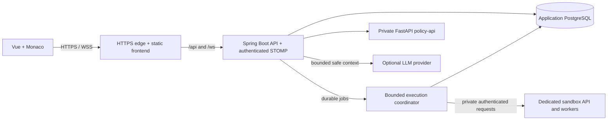

# SocratesAI evolution: architecture blueprint and implementation checklist

**Status:** Plan approved. The authorized Steps 1–2 schema scope, Step 3 adapter and Step 4 secure authoring APIs are implemented and locally verified. Actual sandbox hosting/execution, the frontend catalog transition and remaining phases stay explicitly unchecked.
**Prepared:** 2026-10-21.
**Last updated:** 2026-10-22. See [result-1-schema.md](./result-1-schema.md) for schema/contracts and [result-3-sandbox.md](./result-3-sandbox.md) for adapter verification and the missing execution host. See [result-4-authoring.md](./result-4-authoring.md) for role provisioning, authoring, publication and collection contracts/tests.
**Workspace:** `/home/koshikovalimzhan/IdeaProjects/socratesai`.
**Task folder:** `tasks/socrates-evolution/` relative to the repository root. The requested `/tasks/...` paths refer to this repository folder, not an operating-system directory.
**Requirements source:** [task-context.md](./task-context.md), read before preparing this plan.
**Project constraints:** [AGENTS.md](../../AGENTS.md).

This document is the implementation handoff and persistent progress record. It defines the proposed architecture, dependencies, decisions, acceptance criteria, and ordered work. An unchecked item is future work, not an implemented capability or a verified result.

## 1. Objective, scope, and completion criteria

Evolve SocratesAI into a programming practice platform where teaching staff author problems and arrange them into collections, students solve those problems in multiple languages, and the existing bounded mentor assistance continues to react to code edits through WebSocket, ML inference, and optional LLM wording.

The first production release includes:

1. Authenticated student, teacher, and administrator workflows with server-enforced permissions and resource ownership.
2. Native problem authoring, test cases, language configurations, draft/publish/archive lifecycle, and ordered problem collections.
3. A student catalog, collection pages, a multilingual Monaco workspace, sample runs, formal submissions, verdicts, and submission history.
4. Isolated compilation and execution with real resource limits, asynchronous judging, durable job tracking, and protection of hidden tests.
5. Preserved formative mentor feedback, logging, confidence-aware fallback, and an honest indication of which languages have model support.
6. Reproducible containers, continuous integration, controlled delivery, HTTPS hosting, backups, observability, and a tested rollback procedure.

Release acceptance scenario: an administrator provisions a teacher; the teacher creates a native problem with sample and hidden tests, enables validated runtimes, publishes it in a collection; a student opens the collection, switches languages, receives correlated formative feedback while editing, runs samples, submits, receives a genuine judge verdict, and sees the saved submission after refreshing. Another student cannot see their source or feedback, and another teacher cannot mutate the author's content. The same path must work over the production HTTPS endpoint after a repeatable deployment.

Out of scope for this release unless separately requested: timed competitions, rankings, plagiarism detection, custom checker programs, arbitrary compiler flags, student-uploaded packages, interactive problems, institution tenancy, course enrollment, collaborative editing, grading rubrics, new ML training, transformer comparisons, and claims of classroom learning gains. Collections initially organize practice; they are not a full contest scheduling system.

The referenced images are not embedded in the supplied task context. Use a conventional catalog/collection/editor structure provisionally; visual parity with those references remains `[AUTHOR INPUT REQUIRED]`.

## 2. Repository evidence and gaps

These observations come from source inspection, not from a successful test run or deployment in this planning step.

| Area | Observed implementation | Consequence for the plan |
| --- | --- | --- |
| Backend | `pom.xml` declares Java 21 and Spring Boot 4.0.5; REST, JPA, Flyway, JWT, WebSocket, and Actuator are present. | Extend the current backend through cohesive feature modules; avoid a framework rewrite. |
| Users and roles | `User`, `UserRole`, and migration V5 already provide `STUDENT`, `TEACHER`, and `ADMIN`. `AuthService.register` currently accepts a requested role. | Reuse identity tables; prevent public registration from granting staff privileges before enabling authoring. |
| Native tasks | `Task`, `TaskTest`, and V3/V4 already persist tasks and sample/hidden tests. Tasks have one `language`, a starter string, and a `published` boolean. | Evolve this data rather than creating a competing task catalog. Add ownership, versioning, languages, and lifecycle. |
| Task API | `TaskController` exposes published task reads and staff-only create/read. Create requests lack bean validation; service operations have no author ownership checks. | Implement validated CRUD, publication rules, ownership, bounded pagination, and explicit student/teacher DTOs. |
| Catalog | `DashboardView.vue` calls `leetcodeService.js`; external tasks are cached in browser session storage. | Replace the primary catalog with native persistent resources; external IDs cannot become database primary keys. |
| Editor and submission | `TaskSolveView.vue` uses mentor responses to derive an accepted status. `ProgressEstimator` returns heuristic test counts without executing stored tests. | Implement a separate real submission/judging path. Heuristic results must stop granting solved status. |
| Analyzer | `SyntaxCheckEngine` can invoke the Java compiler inside the backend; other languages return a successful syntax flag without compilation. Pattern rules are largely Java-oriented. | Move compilation out of the application host. Unsupported analysis means unknown, not a successful compiler result. |
| WS identity | `/ws` uses SockJS/STOMP; `/app/code.update` returns `/user/queue/feedback`. The interceptor can continue without valid authentication, and the handler trusts message `studentId`. | Enforce CONNECT/SEND/SUBSCRIBE authorization, derive identity from the principal, validate payloads, and correlate replies. |
| Mentor workflow | `MentorWorkflowService` passes numeric `taskId` into analysis/session creation; `MentorService` supplies no task description to feedback generation. | Resolve native problem/version access first and pass a safe problem context to the mentor. |
| ML model | `ml/policy_api.py` serves `/predict-mentor-state`; the default artifact is `ml/codeforces_feedback_need/source_code_model.joblib`. The model uses Python-specific source features, and `language_variant` defaults to Python 3. | Keep Python model support explicit. Other languages require rules/templates and language-appropriate diagnostics until separate evidence exists. |
| Fallback | `MentorPolicyService` already supports ML failure and low-confidence fallback. YAML currently uses a literal minimum confidence of `0.35`. | Preserve these semantics; make threshold configuration consistent with the documented environment variable. |
| Logs | V1/V2/V6/V7/V8 provide sessions, interaction features, outcomes, expert labels, mentor state, and confidence. Historical `task_id` fields are not foreign keys to `tasks`. | Preserve historical fields and add explicit native references; never infer provenance from numeric equality alone. |
| Session concurrency | `StudentTaskSessionService` uses process-local maps and locks. | Use database constraints and atomic updates for correctness across workers/restarts; bound any remaining cache. |
| Production packaging | Root and ML Dockerfiles exist. Production Compose currently contains backend, policy-api, and PostgreSQL, exposes the backend port, and includes fallback secrets. | Add the frontend and TLS edge; require production secrets and private networking. Sandbox infrastructure needs its own trust boundary. |
| CI | `.github/workflows/backend-tests.yml` verifies the backend and frontend coverage. There is no image publication or deployment job in that workflow. | Extend CI with build, ML/contracts, migrations, sandbox integration, and browser tests; add a separate trusted release path. |
| Existing tests | H2 test configuration disables Flyway and creates schemas through Hibernate. | Retain fast tests and add disposable PostgreSQL migration/integration checks. H2 is insufficient evidence for production migrations. |
| Documentation/runtime | README prerequisites differ from the frontend's modern Vite dependencies; existing ML Dockerfile uses Python 3.13. | Select and verify supported toolchains against lockfiles and model dependencies; do not treat README prose as runtime proof. |

Primary files inspected for this blueprint: `pom.xml`; both Spring application YAML files; migrations V1–V8; task, user/auth, session, analyzer, mentor, interaction, and WebSocket modules; frontend package/router/services/editor/catalog code; `ml/README.md`, `ml/policy_api.py`, training entry points and requirements; Dockerfiles; Compose files; `DEPLOYMENT.md`; existing test configuration and CI.

No previous work notes/results were found in this task folder. Existing unrelated untracked datasets, reviewer studies, and paper packages must be left untouched. No secret values should be copied into this document, commit messages, CI logs, or result files.

## 3. Architecture decisions

### 3.1 Overall shape

Retain a **modular Spring Boot monolith** for identity, authoring, collections, student work, mentor orchestration, and judging coordination. Keep the FastAPI model service separate. Delegate untrusted compilation/execution to a dedicated sandbox provider through an application port. Start with PostgreSQL-backed execution jobs rather than introducing an additional application message broker.

Dependency direction within substantial new modules:

`HTTP/WS adapters -> application use cases -> domain rules and ports <- persistence/provider adapters`

Use existing feature packages where appropriate. Extract interfaces at real boundaries, particularly execution, problem context, and external inference; avoid an interface or generic abstraction for every small class. Use Spring transactions around short database operations, not remote calls. Prefer constructor injection with Lombok, readable methods, bounded collections, and streams where they clarify transformations.

The execution coordinator can initially run as a scheduled component and bounded worker pool inside the backend process. The database owns its durable state. It can later run in a separate process using the same application image if measured queue pressure justifies it. Neither application PostgreSQL nor application secrets are available inside execution sandboxes.

### 3.2 Feature boundaries

| Module | Responsibility | Boundary to preserve |
| --- | --- | --- |
| Identity/security | Authentication, current-user resolution, role provisioning, resource access checks. | Never trust identity or role in a student request body. |
| Problems (`task` evolution) | Authoring, versions, language configuration, tests, publish/archive. | Only safe student projections leave this module toward public APIs and mentor prompts. |
| Collections | Ordered references to published problem versions and author lifecycle. | Publishing a collection does not override a problem's access rules. |
| Submissions | Immutable source snapshots, owner history, attempt semantics, progress. | Accepted status is established by complete judge results only. |
| Execution | Job leases, provider adapter, result normalization, limits, reconciliation. | No untrusted compilation or execution in backend, frontend server, or ML containers. |
| Mentor/analyzer | Formative diagnostics, policy choice, bounded hint generation. | Mentor predictions and judge verdicts remain distinct. |
| Interactions/sessions | Existing feedback history, outcomes, expert annotations, additive provenance. | Existing evidence and ML-feature field meanings remain traceable. |

### 3.3 Proposed launch defaults and unresolved choices

These are planning defaults, not verified deployment capacity or final product decisions.

| Decision | Proposed default | When it must be resolved |
| --- | --- | --- |
| Languages | Python 3, Java, and C++17; JavaScript is a possible follow-up. Backend Java 21 does not imply that a sandbox has a Java 21 submission runtime. | Confirm teaching needs and installed sandbox runtimes before publishing the language catalog. `[AUTHOR INPUT REQUIRED]` |
| Problem contract | Standard input/output, one source file, text comparison, no custom checker. | Freeze API and starter-template conventions in Step 1. |
| Collection model | Ordered practice collections; no timers or leaderboard. Published content available to authenticated students by default. | Confirm in Step 1; course/group-restricted assignments remain separate scope. |
| Visibility | New content defaults to authenticated access. Existing explicitly public native tasks may keep public read compatibility. | Finalize route/visibility rules before API cutover. |
| Sandbox | Judge0-compatible adapter; dedicated private self-hosted deployment is the default candidate. A managed compatible service is an alternative. | Validate current security advisories, runtime versions, host requirements, cost, and data handling in Step 3. |
| Hosting | Container-capable application host plus an independently isolated sandbox host; managed application PostgreSQL may replace a local DB container. | Provider, budget, region, account access, domain, and DNS are `[AUTHOR INPUT REQUIRED]`. No paid provisioning is assumed. |
| Performance | Establish latency, concurrency, job throughput, and storage targets on disposable staging. | `[RESULT REQUIRED]`; do not claim a supported student count before measurement. |
| Student source retention | Keep only required submissions and bounded diagnostic data; do not persist every keystroke. | Institution retention/access/deletion policy is `[AUTHOR INPUT REQUIRED]` before real student rollout. |

## 4. Database Schema evolution and identifier migration

### 4.1 Entity design

Reuse `users` and the existing `UserRole` enum as the User/Role model. A separate roles table or multi-role join is unnecessary unless requirements change. Enforce allowed role values and staff-only provisioning at the application boundary.

The logical **Problem** aggregate evolves the existing `tasks` table; keeping its physical primary keys avoids a destructive rename and duplicate catalogs. A Java/domain rename can happen with explicit `@Table(name = "tasks")` mapping and compatibility DTOs. Existing `language`, `description`, `starter_code`, `published`, and `task_tests` remain during the transition; new authoritative writes move through one version-aware use case, not independent old/new services.

| Entity/table | Planned fields and relationships | Invariants |
| --- | --- | --- |
| Problem / `tasks` | Existing `id`; author/owner user FK; lifecycle; visibility; active published version reference; timestamps; optimistic lock version. | Author or admin may mutate. Legacy authorless records require explicit adoption. Archive preserves references. |
| `problem_versions` | Problem FK, revision number, draft/published state, title, statement, topic/difficulty, input/output format, constraints, comparison mode, timestamps. | Unique `(problem_id, revision_number)`; published revisions are immutable; one active draft per problem. Published pointer must refer to that problem. |
| `problem_language_configs` | Problem version FK, allowlisted language key, pinned runtime key/version, starter code, entry point, effective time/memory limits. | Unique `(problem_version_id, language_key)`; runtime settings are validated against operator limits. |
| `problem_test_cases` | Problem version FK, ordinal, input, expected output, sample/hidden flag. | Stable order; nonempty publishable suite; hidden bodies only accessible through authorized authoring/judging paths. |
| `collections` | Owner user FK, title, description, draft/published/archived state, visibility, timestamps, optimistic lock version. | Publication validates every member and reference. |
| `collection_problems` | Collection FK, problem FK, pinned published problem version FK, position. | Unique collection/problem and collection/position; reorder is atomic. Versions cannot silently change underneath students. |
| `submissions` | UUID, student FK, problem/version FKs, optional collection FK, language/runtime, immutable source and source hash, optional session FK, server attempt number, status, verdict, totals, timing, timestamps, idempotency key. | Content and tested version are immutable after acceptance of the request. Only owner/authorized staff can read. |
| `submission_case_results` | Submission FK, versioned test FK, execution generation, normalized status, bounded internal diagnostics, elapsed time, memory, provider token/reference. | Unique per submission/case/generation; public projection omits hidden input, expected output, and hidden-dependent output. |
| `execution_jobs` | UUID, submission reference, run/submit mode, state, lease owner/token/expiry, retries, next retry, provider references, deadlines, timestamps. | Durable work; bounded retry; completion fenced against old leases; no infinite queued/running state. |
| Sample run result | Reuse the execution pipeline with mode `SAMPLE_RUN` and a short-lived result/source record separate from graded submissions. | Runs evaluate public samples only and do not increment graded attempts or solved progress. |
| Sessions/logs | Existing fields plus additive native problem/version, language, code revision/source hash, evidence origin, optional submission reference and fallback reason where needed. | Retain all current ML features, outcome labels, expert-label links, mentor state/confidence, and legacy IDs. |
| Optional import mapping | Verified provider namespace + external identifier -> native problem/version, with provenance and mapping status. | An external ID never shares a primary-key namespace with native problem IDs. No speculative mapping. |

Use PostgreSQL `TIMESTAMPTZ`/Java `OffsetDateTime` for new timestamps and UTC on the wire. Do not reinterpret existing timestamp data without an explicit migration rule. Use DB foreign keys and check constraints for new data; keep JPA cascades conservative. Do not serialize entities directly from controllers.

### 4.2 Problem and collection lifecycle

1. A teacher creates a draft problem, language configurations, and ordered tests.
2. Publishing requires a valid statement, supported runtime(s), bounded limits, at least one public sample and one hidden test, and a successful sandbox verification run using teacher-supplied reference code. Reference code is staff-only, is never sent to the mentor, and should be ephemeral unless retention is explicitly needed.
3. Published versions become immutable. Editing creates or resumes a new draft version; existing submissions continue to reference the original version and tests.
4. A collection pins published versions. Updating a pinned version requires an explicit teacher action and access validation; a student with an older editor snapshot receives a conflict/reload instruction before a new submission is accepted.
5. Drafts with no external references can be deleted. Referenced/published problems and collections are archived; student-facing availability and staff historical access are explicit.
6. Changing collection order or metadata uses optimistic locking. Membership changes never alter the version stored on an existing submission.

### 4.3 Legacy data migration: expand, backfill, switch, retain

The current numeric `task_id` in sessions/logs may describe a local task or an external problem. The same number is not evidence that two rows describe the same problem. Preserve ambiguity rather than attaching an incorrect foreign key.

1. **Inventory:** read schemas, migration checksums, counts, and provenance on a disposable restored copy or through safe read-only access. Record counts, not private row bodies. Take an independently restorable backup before production changes.
2. **Expand:** add version/collection/submission/job structures and nullable native references, leaving existing columns and migrations V1–V8 intact. Allocate new migration numbers after checking the branch at implementation time.
3. **Backfill native catalog:** create revision 1 for every existing `tasks` row, copy its starter/language and tests, and preserve the task primary key. Do not invent expected outputs or author identities. Legacy published tasks missing valid judge suites must remain legacy-readable and be flagged for teacher remediation before accepting formal submissions.
4. **Classify identity:** use a source marker such as `NATIVE`, `IMPORTED_LEETCODE`, or `LEGACY_UNKNOWN`. Only verified historical associations receive native references. Keep unmatched historical `task_id`, sessions, interactions, and expert labels unchanged and report them.
5. **Native writes:** new native sessions/logs populate explicit problem/version/language references; compatibility `task_id` can mirror the native problem ID for those new records only. Do not reuse ambiguous legacy sessions based on the old numeric pair.
6. **Switch adapters:** new APIs and UI use native identifiers. Existing `/api/tasks` routes delegate to the same authoritative problem use cases; published read aliases retain only their explicitly permitted visibility and sample DTOs. Deprecate LeetCode browsing independently.
7. **Strengthen invariants:** enforce valid native references for newly marked native rows, unique active sessions by student/problem/language, and unique version numbers after backfill validation. Resolve duplicate active sessions with a reviewed reconciliation rule; preserve all logs.
8. **Retain:** do not drop historical columns or old tables in this release. Keep a compatibility window for code rollback and exports. A later cleanup requires a separate migration and evidence review.

Use bounded batches and resumable checkpoints for large backfills. Review PostgreSQL locking/index creation behavior on representative staging data. Do not disable Flyway validation or alter an applied migration to make a deployment succeed.

### 4.4 Indexes and query constraints

- Catalog indexes match actual predicates: lifecycle/visibility/publication order and teacher owner/update order.
- Index foreign keys, collection ordering, student submission history `(student_id, created_at, id)`, problem/version history, and pending job eligibility `(state, next_retry_at)`.
- A partial unique index protects one active native session per student/problem/language; native session counters use atomic updates, not JVM locks.
- Unique scoped idempotency keys deduplicate retrying POSTs. Define whether the scope is student plus operation plus key, and reject a reused key with a different source hash/version.
- Use bounded pagination and lightweight summary projections; never load tests or source blobs for catalog/list screens. Prevent N+1 loading with explicit fetches/projections.
- Prefer cheap indexed aggregates for progress; introduce a materialized/cache layer only after query measurement. Do not load a student's entire interaction history to compute a page of submission progress.

## 5. Isolation Sandbox and submission processing

### 5.1 Execution boundary and provider choice

Introduce a small application-facing `CodeExecutionPort` with provider-independent requests/results. Implement a Judge0-compatible adapter as the initial candidate, subject to a security/runtime feasibility gate. Judge0 documents asynchronous submissions, batch APIs, language discovery, and execution constraints; the public API documentation describes version 1.13.1, so it is not proof of a currently suitable deployment. Verify the chosen release and installed runtimes during implementation. [Judge0 API documentation](https://ce.judge0.com/)

Do not hard-code provider language IDs from a public demo. Resolve an operator-approved catalog of installed runtime IDs, versions, and entry-point conventions; cache it with a bounded refresh and fail unavailable languages explicitly. Never rely on an unowned public demo endpoint for student work.

Self-hosting belongs on a dedicated execution host/VM, separate from application data and secrets. A managed compatible provider can replace it after checking hidden-test/source retention, quotas, region, and cost. The adapter keeps provider selection out of problem and submission domain logic. Do not build a custom container scheduler, unsafe local process runner, or arbitrary shell execution fallback as an expedient substitute.

### 5.2 Isolation requirements

- Compile and execute student code only inside the sandbox, including syntax/compiler checks; remove in-process Java compilation from the production editing path.
- Use fresh disposable workspaces, restricted filesystem access, process/user separation, CPU and wall deadlines, memory/process/file/output quotas, and reliable cleanup of child processes and temporary files.
- Deny submission network access, including internet, host metadata endpoints, private networks, and application services. Prove this with a sandbox test, not only a Compose network setting.
- Never mount application directories, credentials, database sockets, or the host Docker socket into a student execution environment. Do not give the backend a Docker socket.
- Expose the sandbox API only to the execution coordinator over a private authenticated channel. Students cannot call it directly or select provider URLs, callback URLs, compiler options, images, packages, or limits beyond the allowlist.
- If the execution engine needs privileged host components, keep them solely inside the dedicated execution trust zone, with no shared application volumes or credentials. A normal container alone is not the isolation justification.
- Review current engine advisories, patch status, kernel/cgroup requirements, and privileges before approval of an image digest. The upstream changelog records fixes for earlier critical escape vulnerabilities; a version string alone is insufficient. [Judge0 changelog](https://github.com/judge0/judge0/blob/master/CHANGELOG.md)
- Bound diagnostics before buffering/decoding, including malformed encodings and very large provider responses. Do not return a hidden case's stdout/stderr: a submitted program can echo its input.
- For managed execution, confirm deletion/retention and transport/authentication requirements before sending real student source or private tests.

Initial quota proposals: retain the existing 20,000-character edit-source ceiling, add an explicit UTF-8 byte ceiling for all code paths, cap test count/input/output sizes per version, and enforce per-user outstanding jobs plus a global worker cap. Specific CPU/memory values must account for each approved runtime and host capacity; record validated numbers in configuration after the sandbox spike. Never claim arbitrary concurrent student capacity from these proposed limits.

### 5.3 Execution contracts and result semantics

Both Run and Submit use the same validated language/runtime mapping and versioned problem context:

- **Run samples:** public samples only, bounded result TTL, no graded attempt, sample diagnostics may be returned within caps.
- **Submit:** all required tests from the pinned immutable version; source and runtime captured once; attempt number assigned by the server; hidden case bodies and derived output remain private.
- **Reference verification:** staff-only execution against the complete draft suite before publication, with strict source/output handling and the same sandbox limits.

Choose deterministic text comparison for launch: normalize CRLF to LF and tolerate final line endings according to a documented policy; retain meaningful spaces. Do not globally trim all whitespace. Store comparison policy with the problem version. Float-tolerance and custom-checker contracts are later features.

Keep execution **status** separate from final **verdict**:

| Status | Meaning |
| --- | --- |
| `QUEUED` | Validated source/version is durable and awaiting capacity. |
| `DISPATCHING` | A worker holds a lease and is creating/recovering provider work. |
| `RUNNING` | One or more provider executions are pending. |
| `FINISHED` | Required results were aggregated into a student verdict. |
| `SYSTEM_ERROR` | Infrastructure/provider failure prevented a trustworthy verdict. |

Student verdicts include `ACCEPTED`, `WRONG_ANSWER`, `COMPILATION_ERROR`, `RUNTIME_ERROR`, `TIME_LIMIT_EXCEEDED`, `MEMORY_LIMIT_EXCEEDED`, and `OUTPUT_LIMIT_EXCEEDED` when the provider can distinguish them. Provider-specific ambiguity remains a normalized infrastructure/limited-detail error; do not invent distinctions the provider cannot measure.

Only a complete valid suite with every required test passing produces `ACCEPTED`. An empty suite, partial response, compile check alone, model state `accepted`, timeout, or unavailable sandbox cannot produce accepted status. Full submissions run all bounded cases for meaningful counts; if runtime policy aborts early, remaining cases are explicitly unexecuted, not passed/failed by guesswork. Evaluate judge tokens/statuses, not student-controlled stdout strings.

### 5.4 Durable job workflow and recovery

1. Authenticate and authorize the student; validate published problem/version, collection context, runtime, source limits, idempotency key, and outstanding-job quota.
2. In one short transaction, insert the submission or sample-run snapshot and execution job. Return `202 Accepted`, its identifier, and a status URL. No browser request waits for the complete test suite.
3. Claim a bounded job batch atomically, using PostgreSQL row locking such as `FOR UPDATE SKIP LOCKED` and expiring leases. Commit before network calls.
4. Snapshot trusted test/runtime metadata from the immutable version and submit bounded provider batches. Persist returned tokens immediately and map every token to its case/generation. Some providers recompile for each case; account for that cost in test-count and concurrency caps rather than claiming compile-once behavior.
5. Poll outstanding tokens with backoff and a total deadline. Use polling first; no public result webhook is necessary for this release.
6. Store bounded per-case results and aggregate atomically. Check job lease/generation before completion so a stale worker cannot overwrite a newer result.
7. Update server-side progress/counters once for the accepted submission identity. Publish a user-scoped completion notification after commit; HTTP status polling remains the recovery source of truth.
8. On restart, reclaim expired leases and reconcile already-known provider tokens. Queue storage, not in-memory futures, determines pending work.
9. Treat provider-create timeouts as ambiguous: the remote job may already exist. Without provider idempotency/reconciliation, allow only a bounded, recorded retry or finish with `SYSTEM_ERROR`; never promise exactly-once remote execution or blindly recreate the whole batch.
10. Reap abandoned work and expired sample-run records. Terminalize jobs that exceed retry/deadline limits; allow an explicit retry linked to the prior failed evaluation rather than silently rewriting history.

Queue correctness comes before throughput tuning. Keep network/compile waits off WebSocket inbound threads and outside database transactions. Measure sustained arrival rate, queue age, provider capacity, and compiler overhead in disposable staging before raising limits.

## 6. Teacher API Layer and authorization

### 6.1 Access model

| Operation | Student | Teacher | Admin |
| --- | --- | --- | --- |
| Browse permitted published problems/collections and samples | Yes | Yes | Yes |
| Create/edit/publish/archive content | No | Own content | Any content |
| Read hidden tests/reference verification details | No | Own content | Any content |
| Run/submit code and read own history | Own | Own, with separate author preview | Own, with separate author preview |
| Review other students' submissions | No | Only problems owned by that teacher; no global student export | Authorized administrative scope |
| Assign teacher/admin roles | No | No | Yes, through an audited operation |
| Read/label/export research interactions | Own feedback where appropriate | Explicit research/teaching scope | Explicit administrative scope |

Public registration always creates students. Reject attempts to request a privileged role rather than silently trusting a client field. Bootstrap the first admin through an operator-controlled one-time procedure with no default password; later role changes require admin authentication and audit. Verify current database roles instead of trusting a UI route or a stale client claim.

Centralize current-user lookup and resource access policies, then apply them consistently to REST, WS, exports, status polling, legacy routes, and worker-created events. Use not-found responses for inaccessible private resources where appropriate. Role annotations alone do not establish ownership.

### 6.2 Proposed resource routes

Exact request schemas and errors are frozen in Step 1 before implementation. These route families are the intended contract:

| API | Purpose |
| --- | --- |
| `GET /api/languages` | Supported, operational runtime catalog with labels and mentor capabilities. |
| `GET /api/problems` / `GET /api/problems/{id}` | Paginated permitted published summaries/detail; sample cases only. |
| `GET /api/collections` / `GET /api/collections/{id}` | Paginated permitted collections and ordered pinned problems. |
| `POST /api/teacher/problems` | Create an owned problem draft. |
| `GET /api/teacher/problems` / `GET /api/teacher/problems/{id}` | Own catalog/detail with authoring fields and hidden tests. |
| `POST /api/teacher/problems/{id}/draft` | Create/resume a draft revision from a published version. |
| `PUT /api/teacher/problems/{id}/draft` | Atomically save validated statement, languages, tests, and optimistic version. |
| `POST /api/teacher/problems/{id}/verify` | Queue staff-only reference verification and expose its result to the owner. |
| `POST /api/teacher/problems/{id}/publish` | Publish the verified draft after rechecking its exact revision hash. |
| `POST /api/teacher/problems/{id}/archive` / `DELETE .../{id}` | Archive referenced content; delete only eligible unreferenced drafts. |
| `POST/GET /api/teacher/collections` | Create/list owned collection drafts. |
| `GET/PUT/DELETE /api/teacher/collections/{id}` | Read/update/delete eligible drafts with ownership and conflict checks. |
| `PUT /api/teacher/collections/{id}/problems` | Replace/reorder bounded membership atomically using explicit published version references. |
| `POST /api/teacher/collections/{id}/publish` / `.../archive` | Validate and transition collection lifecycle. |
| `POST /api/problems/{id}/runs` / `GET /api/runs/{runId}` | Asynchronous sample execution and owner-only result polling. |
| `POST /api/problems/{id}/submissions` | Idempotent formal submission; returns `202` and status location. |
| `GET /api/submissions/{id}` / `GET /api/me/submissions` | Owner-scoped status/detail and paginated source-free summaries. |
| `GET /api/teacher/problems/{id}/submissions` | Paginated submissions for an owned problem, subject to privacy policy. |
| `PATCH /api/admin/users/{id}/role` | Audited staff-role provisioning; no public elevation. |
| Existing mentor/interaction routes | Preserve safe contracts through adapters; enforce identity/ownership and stop trusting supplied grading signals. |

Use a consistent structured error response with a safe message, code, and request ID. Distinguish invalid input (`400`), authentication (`401`), permissions (`403` or concealed `404`), stale revision/idempotency conflict (`409`), source/body limits (`413`), unsupported content (`415` where applicable), throttling (`429`), and unavailable infrastructure (`503`). Do not expose SQL, hidden test bodies, raw provider payloads, or LLM secrets in errors.

Input validation includes title/statement/test/source byte lengths, bounded nested collections with `@Valid`, allowed languages, safe Markdown, time/memory limits, duplicate membership, and revision concurrency. Description rendering uses escaped Markdown or an explicitly sanitized HTML pipeline; do not render raw stored HTML with unrestricted `v-html`.

## 7. WS/ML adjustment and research continuity

### 7.1 Native problem context and message contract

Keep the existing `/ws`, `/app/code.update`, and `/user/queue/feedback` destinations where compatible, but strengthen authentication and add explicit versioned message fields. An editor update contains:

- `protocolVersion`, `requestId`, and a random per-tab `editorSessionId`;
- native `problemId`, pinned `problemVersionId`, and allowlisted `languageKey`;
- monotonic `codeRevision`, source hash if useful, and a bounded source snapshot.

The server supplies the student identity, native learning session, attempt number, access decision, and trusted analysis context. Remove or reject client `studentId` and client-derived test/compile outcomes on normal student paths. Compatibility DTOs may accept legacy field names only with explicit native resolution and identity equality validation; raw `taskId` must not bypass source/provenance checks.

Monaco produces code diffs locally. Coalesce them into the latest bounded full snapshot for the first release, preserving the current simple transport. This maps every edit to a database problem/version without introducing fragile server-side patch reconstruction. A later true-diff protocol must carry a base revision and request full resynchronization after a gap; it is not a launch dependency.

Replies echo request/editor/problem/version/language/code revision and include feedback source, analysis evidence type, mentor-state/confidence when applicable, and a safe degraded-mode reason. Client and server ignore obsolete responses after typing, switching language/problem, or reconnecting. A per-user reply queue still requires tab/session correlation; it alone does not isolate editors across browser tabs.

### 7.2 End-to-end formative path

1. Reject missing/invalid/expired CONNECT credentials. Bind the STOMP user to the validated account and enforce SEND/SUBSCRIBE destination allowlists; prevent clients publishing to broker queues or subscribing to other users' destinations. Check trusted origins as well as token authentication.
2. Validate a native published version and language against the principal's access policy on each relevant editor context change; cancel or invalidate work after access changes.
3. Debounce edits, drop unchanged hashes, enforce byte/frame limits, rate-limit per user, and keep at most one in-flight formative analysis plus the newest pending snapshot per editor.
4. Run cheap bounded language-appropriate diagnostics. Do not compile or execute code in the application process. Explicit sample runs can enrich later feedback, but hidden tests are never executed or revealed on each keystroke.
5. For eligible Python source, call the existing source-code mentor-state model through `/predict-mentor-state`; preserve action mapping and confidence/failure fallback. For unsupported languages, use clearly labeled rules/templates and validated compiler feedback from explicit sample runs.
6. Assemble a mentor-safe context from the local problem statement, public samples, language, and source revision. Exclude hidden cases, expected hidden outputs, reference solutions, private teacher notes, and other students' data.
7. Call optional LLM wording with strict timeouts, concurrency/token budgets, and bounded context; fall back to deterministic templates. Treat source/comments as untrusted input. Avoid sending complete solutions or unrestricted answer-generation instructions.
8. Save an interaction using existing feature fields plus explicit native provenance/evidence metadata. Editing/Ask Mentor records formative feedback, not a graded attempt or proof of a passed test.
9. Send a correlated reply only to the authorized user/editor context. WS failure leaves explicit HTTP mentor requests and submission polling usable; reconnect is bounded and resends only the latest snapshot.

Spring Security treats messaging authorization as a separate concern from allowing the HTTP handshake. Implement and test the required inbound messaging policy using APIs compatible with the project's pinned version, including the intentional bearer-token CONNECT/CSRF/origin behavior. [Spring WebSocket security documentation](https://docs.spring.io/spring-security/reference/servlet/integrations/websocket.html)

### 7.3 Model and feature boundaries

- Preserve `/predict-mentor-state`, default `source_code_model.joblib`, `MENTOR_STATE_MODEL_PATH`, `PolicyFeatures` compatibility, and `interaction_logs.mentor_state`/`mentor_state_confidence` semantics.
- Make language eligibility explicit before inference; do not let Python defaults silently label Java/C++ requests as Python. FastAPI should validate language support as defense in depth.
- Maintain confidence-aware rule fallback and log its reason. Bind `APP_POLICY_ML_MIN_CONFIDENCE` consistently in configuration rather than changing the current numerical behavior incidentally.
- Source-only editing predictions remain source-only. The current API truncates model text to 5,000 characters; expose/document that limit and regression-test it instead of implying full-source inference for longer editor buffers.
- Represent unavailable compiler/test evidence as unknown in new orchestration/DTOs. Audit old non-null model inputs and provide a documented compatibility mapping only where necessary; never log heuristic counts as actual judge evidence.
- Separate `STATIC_HEURISTIC`, `SAMPLE_RUN`, and `JUDGED_SUBMISSION` evidence origins. Attach run-derived facts only to the exact problem version, language, and source hash that produced them.
- Keep a model-predicted `accepted` mentor state separate from the submission `ACCEPTED` verdict. The former cannot mark a problem solved.
- Do not switch to execution-enriched models, retrain, or claim cross-language validity as part of deployment. Any future model change requires saved artifacts and a separate evaluation protocol.
- Guard logging: `MlPolicySelector` currently includes payload/body in some exceptions, and fallback logging can propagate exception messages. Remove source/secret leakage while retaining safe status/request IDs.
- Audit feedback outcome updates, expert-label endpoints, and dataset exports for ownership/role checks. Student source, comments, and session-linked logs remain sensitive.

### 7.4 Paper and experiment alignment

Keep public Codeforces submissions, synthetic/weak policy CSVs, real interaction logs, expert labels, and scripted benchmark events separate. Preserve old artifacts; mark new implementation behavior and evaluation provenance explicitly.

When the mentor pipeline changes, inspect IEEE text for endpoint, threshold, stored-field, analyzer/test-evidence, and language-support statements. If text must change, synchronize the two intended IEEE TeX copies and verify inline citations, figures, and rebuilt PDFs before claiming a paper build. Do not silently edit other paper packages. No new result is claimed here; use `[RESULT REQUIRED]`, `[CITATION REQUIRED]`, `[VERIFY FROM ARTIFACT]`, or `[AUTHOR INPUT REQUIRED]` where appropriate.

## 8. Frontend architecture and workflows

Retain Vue 3, Vite, Pinia, Axios, Monaco, and the existing mentor components. Prefer focused views/components and feature service modules over a large replacement of `TaskSolveView.vue`.

| Screen/feature | Planned behavior |
| --- | --- |
| Student catalog | Native paginated problems/collections; filters supported by server indexes; loading/empty/error states; progress from real accepted submissions. |
| Collection detail | Ordered problems with pinned versions, available runtimes, and the student's persisted submission progress. |
| Problem workspace | Statement, formats, constraints, public samples, Monaco, language selector, Run samples, Submit, mentor panel, execution results, and connection status. |
| Submission history/detail | Poll queued/running work with backoff; display genuine normalized verdicts, measured resources when available, and own historical source. Never expose hidden diagnostics. |
| Teacher dashboard | Own problem/collection lists, draft/published/archived states, filters, and create/edit actions. |
| Problem editor | Statement, language starters, resource limits, sample/hidden test editor, validation, reference verification, publish/archive, and stale-update handling. |
| Collection editor | Add published owned problems, reorder, pin/update versions explicitly, preview student projection, publish/archive. Cross-teacher problem reuse is deferred. |
| Admin controls | Minimal staff-role provisioning UI or documented operator/admin API workflow; no teacher role selector on public registration. |

Language metadata is obtained from `/api/languages` and intersected with the problem's enabled languages. Do not duplicate arbitrary compiler IDs across Vue and Java. Starter code follows the launch stdin/stdout contract, including a documented Java main-class convention.

Keep a separate in-memory editor buffer per problem/version/language to prevent overwrites on switching. Warn before discarding unsaved edits. Persistent draft autosave is optional follow-up; if added, partition it by user and clear it on logout/shared-device use. Do not persist every keystroke to PostgreSQL.

Use feature services for problems, collections, submissions/runs, and teacher actions; reuse the Axios authentication/error layer. Route metadata can hide staff screens, but APIs remain authoritative. Preserve token handling compatibility initially, audit XSS/logging/storage risks, clear sockets and transient source on logout, and never embed tokens in URLs or build-time frontend variables.

Split formative feedback state from sample-run and submission state. Slow replies cannot replace a new editor revision or newer submission. Render escaped output; cap visible diagnostics. Expose recovery for WS failure, expired login, sandbox unavailability, stale problem version, and teacher update conflicts.

Production serves the built SPA with history fallback for frontend routes only. `/api` and `/ws` must proxy correctly, including SockJS fallback transports and WebSocket upgrades; API errors must not become `index.html` responses. Validate keyboard access, readable status indicators, responsive panes, and language/editor accessibility.

## 9. CI/CD/Hosting architecture

### 9.1 Environments and container topology

| Environment | Application services | Execution services and data policy |
| --- | --- | --- |
| Local development | Backend, frontend/dev server, policy-api as needed, dedicated local PostgreSQL. | Disposable sandbox or explicit test adapter; synthetic fixtures only. |
| CI | Built services, disposable PostgreSQL with Flyway, provider contract stub, selected real sandbox integration on an isolated trusted runner. | No shared DB, student data, production credentials, or privileged PR workflow. |
| Staging | Production-like images, HTTPS domain, private policy-api and application DB. | Dedicated sandbox namespace/host and synthetic seeded users; no uncontrolled shared staging database. |
| Production | HTTPS edge, static frontend, backend, policy-api, private PostgreSQL or a managed replacement. | Separate execution host and engine-specific storage/queue services, isolated from application DB and secrets. |

The required application mesh includes `backend`, `frontend`, `policy-api`, and `postgres`. The sandbox is an additional deployment unit; if self-hosted Judge0 needs its own workers, queue, or database, include and operate them explicitly rather than hiding them inside the application containers.

The frontend image can provide the TLS/static/reverse-proxy edge, or a small dedicated edge service can sit in front of it. Select one approach in the infrastructure spike and keep `/api` and `/ws` on the same origin. Only HTTPS/HTTP redirect ports are public. Database, model, sandbox administration, and backend internal ports remain private.

Start with Docker Compose for the application host and separate sandbox infrastructure. Use immutable image digests and persistent named volumes. Do not add Kubernetes or a service mesh without a demonstrated need. A single application host is an initial operating choice, not an HA claim; document its failure/recovery limits.

### 9.2 Build and configuration rules

- Backend: multi-stage Java 21 build, non-root runtime, resource/health settings; no compiler or code runner required in the runtime image after isolation changes.
- Frontend: pinned supported Node build environment, `npm ci`, Vite production bundle, lean static runtime, proxy/history fallback configuration.
- Policy API: verify pinned Python/dependency/model compatibility, package only required runtime artifacts, record model checksum/version, run non-root, expose readiness only after model load.
- Select toolchains from actual package requirements and successful builds. Local Node 16 discovery is not a suitable frontend validation environment for the current Vite dependency; provision a compatible version during implementation.
- Build contexts exclude `.env`, private datasets, student exports, papers, caches, and unrelated untracked research files. Do not transmit the entire repository as an unfiltered deployment archive.
- Production requires DB credentials, JWT signing secret, exact trusted origins, provider tokens, and deployment credentials; remove unsafe fallback secrets. Commit `.env.example` with placeholders only.
- Keep `MENTOR_STATE_MODEL_PATH`, policy mode/path/version/threshold, LLM enablement/models/timeouts, sandbox endpoint/token/runtime mapping, quotas, worker concurrency, and job TTL/deadlines configurable.
- Validate required configuration before startup. Public frontend variables are never secrets. Avoid logging resolved environment files or `docker compose config` with interpolated credentials.
- Retain optional LLM provider order/fallback intentionally; existing env keys do not prove provider availability, paid quota, or production permission.

### 9.3 Continuous integration and delivery

1. PR CI runs Java verification, frontend unit/coverage/build, Python inference/contracts, PostgreSQL migrations, and lint/config validation where supported. Preserve existing coverage gates and extend their file coverage for new modules.
2. CI uses dedicated test profiles with LLM calls disabled and deterministic provider stubs. An additional isolated sandbox suite proves actual compilation/execution and isolation; mocked results alone cannot certify the sandbox.
3. Run browser E2E through teacher authoring -> collection -> student editing/WS -> run -> submit -> history; include denied access and stale response cases.
4. On a reviewed trusted release, build backend/frontend/policy images, scan dependencies/images, record SBOM/image/model digests, and publish to a configured registry. Pin third-party workflow actions to reviewed immutable revisions.
5. Promote the exact tested digests to staging, run smoke checks, and retain a deployment manifest with schema compatibility, artifact IDs, and results.
6. Production deploy uses a trusted branch/tag or explicit dispatch and the configured environment policy. Serialize deployments per environment; untrusted PR code cannot access deployment secrets. GitHub supports environment policies and deployment concurrency, whose availability/settings must be checked for the actual repository. [GitHub deployment controls](https://docs.github.com/en/actions/how-tos/deploy/configure-and-manage-deployments/control-deployments)
7. Use OIDC/provider short-lived credentials when available; otherwise a narrowly scoped deploy identity with host-key verification and protected secrets. Never disable SSH host verification or run untrusted jobs on a production host.
8. Complete image preparation, migration compatibility checks, backup verification, and staging tests before a production approval point. Do not add repeated ad hoc permission steps to routine implementation; honor the user's eventual hosting policy.

The DTO/schema implementation was initially left in the working directory as requested. On 2026-10-22 the user explicitly authorized pushing these changes: create a scoped semantic commit and push it to the current branch, excluding unrelated datasets, paper packages, and other pre-existing untracked files. No provisioning or deployment is part of this authorization.

### 9.4 Deployment, rollback, and operations

1. Select host/provider/region/domain after access and budget are supplied; confirm sandbox kernel/runtime prerequisites before purchasing or provisioning anything.
2. Provision isolated application and execution networks, a restricted operator identity, secret storage, TLS certificates/renewal, persistent storage, and off-host encrypted backups.
3. Restore a backup into an isolated database and prove recovery before production data migration. Define RPO/RTO with the owner; values are `[AUTHOR INPUT REQUIRED]`, measured restore time is `[RESULT REQUIRED]`.
4. Pull signed/verified release digests, validate non-secret config, acquire one deployment/migration lock, apply expand-only migrations through a controlled release step, and run schema validation.
5. Start services in readiness order, register/check permitted runtimes, load the model, and run authorized synthetic smoke tests through HTTPS and WS.
6. Verify real sandbox verdicts, privacy boundaries, LLM/template fallback, logs, backups, and container restart recovery. Record the deployment URL, release ID, checks, and unresolved limits.
7. On failed health/smoke checks, roll back application image digests while keeping the compatible expanded schema. Do not run automatic destructive down-migrations. A data restore is an operator decision with explicit impact and a rehearsed procedure.
8. Alert on API errors, rejected auth/authorization, WS disconnect/backlog, ML fallback/error rates, execution queue depth/oldest age, stalled leases, compiler/runtime failures, storage pressure, backup failures, and TLS expiry. Metrics/logs carry correlation IDs, not source/test bodies or tokens.
9. Document quotas, retention/cleanup, admin provisioning, language/model update procedure, incident handling, secret rotation, and database/sandbox recovery in `DEPLOYMENT.md` and task results.

## 10. Sequential implementation checklist

Work proceeds in the order below. Each stage ends with a scoped reviewable change, relevant automated checks, and a result note in this folder. Dependencies are mandatory even where read-only preparation could overlap. All application tasks below remain unchecked.

### Step 0 — Planning baseline (this deliverable)

- [x] **P0.1** Read the task-specific context and repository instructions.
- [x] **P0.2** Inspect the existing native task schema, external catalog path, roles/auth, analyzer, WS, ML, deployment files, and tests.
- [x] **P0.3** Record observed gaps, preserve research boundaries, and distinguish proposed decisions from evidence.
- [x] **P0.4** Write this blueprint and sequential checklist without application changes.

**Exit:** This document exists and references the authoritative task context. No application implementation or deployment has occurred.

### Step 1 — Freeze contracts, access rules, and migration inputs

**Depends on:** Step 0. **Primary areas:** task/security/mentor DTOs, API design, operator decisions.

- [ ] **P1.1** Confirm launch languages and stdin/stdout conventions; record exact runtime requirements separately from backend Java 21.
- [ ] **P1.2** Confirm collection visibility and practice-only scope; record deferred classroom grouping/timed-contest features.
- [ ] **P1.3** Define author ownership, admin bootstrap/role provisioning, legacy author adoption, and staff submission-review permissions.
- [x] **P1.4** Inventory every caller of numeric `taskId`, including frontend routes, sessions, interactions, profile progress, exports, benchmarks, and tests. Recorded in `result-1-schema.md`; callers remain compatible.
- [x] **P1.5** Produce the legacy/native identifier and provenance contract; identify ambiguous records without modifying shared databases. V9 preserves unknown links, including numeric collisions; no shared-record inspection/mapping is claimed.
- [x] **P1.6** Specify problem/version/language/test/collection DTOs, publication validation, visibility, pagination, safe errors, and conflict semantics. Typed DTOs and validation implemented; the blueprint/report specify service rules, while HTTP envelopes/controllers remain Step 4 work.
- [x] **P1.7** Specify run/submit status/verdict DTOs, idempotency behavior, test comparison, quotas, attempt counting, and history authorization. Contracts frozen; comparator/adapter implemented in Step 3, while worker/authorization use cases remain future implementation.
- [ ] **P1.8** Specify the correlated WS protocol, identity source, payload limits, language eligibility, and nullable/unknown execution evidence.
- [ ] **P1.9** Record provider/host/domain/access/region/budget, retention rules, RPO/RTO, and open decisions using explicit missing-input markers.
- [x] **P1.10** Write the requested combined `result-1-schema.md` with contracts, compatibility changes, implemented schema, and the test matrix; update this checklist. Remaining external decisions are explicitly open.

**Exit:** Request/response and security contracts are reviewable; no unresolved identity or grading ambiguity is hidden behind implementation defaults.

### Step 2 — Database Schema and backward-compatible migration

**Depends on:** Step 1. **Primary areas:** `db/migration/`, task/user/session/interaction models and repositories.

- [x] **P2.1** Create disposable PostgreSQL fixtures covering empty DB, populated native tasks, ambiguous legacy external IDs, hidden tests, sessions, and expert labels. Testcontainers PostgreSQL 16; no shared database access.
- [x] **P2.2** Add ownership/lifecycle/visibility/concurrency columns to the existing native task root without changing current primary keys. Existing `Task` remains the Problem aggregate.
- [x] **P2.3** Add problem versions, per-version language configurations, and versioned ordered tests with required keys and constraints.
- [x] **P2.4** Add collections and ordered pinned problem references; enforce valid version ownership and membership uniqueness. Publication/access policy remains Step 4.
- [x] **P2.5** Add submissions and bounded per-case results, with immutable source/version/runtime references and scoped idempotency keys. Shared `execution_case_results` also serves samples/reference verification.
- [x] **P2.6** Add durable execution jobs, run-mode records, retry/deadline/lease metadata, and worker-eligibility indexes. Transactional locking repository tested; dispatch/recovery worker remains Step 5.
- [x] **P2.7** Add native context/evidence fields to sessions and interaction logs while retaining every existing feature/outcome/expert-label field.
- [x] **P2.8** Implement bounded catalog backfill; preserve task IDs, original starter code/tests, and explicit legacy author/provenance status. Atomic V9 uses 500-task statements; 503 tasks/1006 cases verified; runtime snapshots remain unverified.
- [ ] **P2.9** Backfill historical log links only where provenance is verified; produce counts of linked/unresolved rows without exporting sensitive content.
- [ ] **P2.10** Reconcile duplicate active native sessions under a reviewed rule, then add partial uniqueness and atomic counter updates. Partial native-only unique index is implemented/tested; old sessions are untouched and atomic service counters remain pending.
- [x] **P2.11** Add query projections/indexes and bounded pagination; verify lists do not fetch hidden tests or source blobs. PostgreSQL SQL inspection verifies checked catalog/submission summaries.
- [x] **P2.12** Test migrations from V8 and from an empty DB on real disposable PostgreSQL; verify repeat migration, Flyway validation, and Hibernate validation. Full backend verify passed.
- [ ] **P2.13** Verify row counts, log fields, expert-label links, and old export column compatibility after migration; rehearse compatible application rollback.
- [x] **P2.14** Write the requested combined `result-1-schema.md` with migration order, backfill rules, verification evidence, and unresolved legacy mappings.

**Exit:** Schema upgrades preserve historical research data and support native authoring/submissions on disposable PostgreSQL; no shared DB was mutated by tests.

### Step 3 — Isolation Sandbox feasibility and adapter

**Depends on:** Steps 1–2 contracts/schema; do this before claiming language support. **Primary areas:** execution module and dedicated sandbox infrastructure.

- [ ] **P3.1** Review provider release/advisories/host privileges and installed runtime versions; document self-hosted versus managed choice and operational cost assumptions. Partial: primary release/advisory review and dedicated-host versus managed tradeoff recorded in `result-3-sandbox.md`; actual host/image/runtime approval and cost remain open.
- [ ] **P3.2** Establish an isolated local/staging execution environment without application secrets, mounts, or shared database access. User confirmed no Judge0 server is available; localhost protocol fixtures never execute source.
- [x] **P3.3** Implement `CodeExecutionPort`, provider request/result DTOs, bounded HTTP client, authentication, and error normalization. Implemented and tested; disabled by default until operator configuration and isolation verification.
- [ ] **P3.4** Discover and validate the approved runtime allowlist; map language keys, runtime versions, entry points, and starter conventions centrally. Partial: configured ID/key/version/full-name allowlist and cached `/languages` verification implemented; real catalog, approved entry points and templates await the host.
- [x] **P3.5** Implement asynchronous provider create/poll and bounded batch mapping; prohibit user-selected provider URLs/options/callbacks. Poll-only retries, exponential backoff, original absolute deadline, cancellation and bounded concurrency verified over local HTTP.
- [ ] **P3.6** Enforce source/stdin/output/file/process/CPU/wall/memory constraints, compile limits where supported, and safe decode limits. Partial: request/UTF-8/HTTP/Base64 bounds and explicit provider resource/network flags implemented; actual host enforcement and compile-specific limits require an isolated runtime.
- [x] **P3.7** Implement normalized verdict mapping and deterministic comparison rules; explicitly handle unsupported memory/output status distinctions. All documented status IDs, local output comparison, unsupported memory distinction and unknown/incomplete responses tested.
- [ ] **P3.8** Test valid/wrong/syntax/runtime programs in every proposed language and verify compiler versions against catalog labels.
- [ ] **P3.9** In a disposable sandbox only, test infinite loop, memory pressure, process spawning, output flood, filesystem access, network denial, timeout cleanup, and worker restart.
- [ ] **P3.10** Verify no source or hidden-dependent output escapes through logs/errors; verify private endpoint auth and network boundaries. Partial: hidden-echo DTO tests, diagnostic removal, safe exceptions/logging, authentication headers, redirect rejection and bounded responses pass; real private-network/proxy/APM boundaries remain unverified.
- [ ] **P3.11** Measure compile/test overhead and set justified initial per-language and global quotas in configuration.
- [x] **P3.12** Write `result-3-sandbox.md` with provider/image/runtime digests, settings, isolation evidence, limitations, and commands. Missing deployment evidence is explicitly marked; operator/integration instructions are in `docs/sandbox.md`.

**Exit:** Every advertised language executes in a tested isolated environment; isolation failure blocks public code execution. Provider mocks alone do not satisfy this exit.

### Step 4 — Teacher API Layer, secure authoring, and collections

**Depends on:** Step 2 and Step 3 for verification/publication. **Primary areas:** auth/security, problem/task, collection modules.

- [x] **P4.1** Restrict public registration to students and add privilege-escalation regression tests. Implemented in validation/service; public staff signup is rejected, and the registration UI offers only student signup.
- [x] **P4.2** Implement audited first-admin provisioning and admin-only role changes with no default credentials. External opt-in bootstrap, serialized last-admin protection, atomic append-only audit, expected-role conflicts and stale-JWT role revocation verified.
- [x] **P4.3** Centralize current-user/resource policies and test teacher A/teacher B/student/admin access. CurrentActor, problem/collection ownership guards and same-policy legacy facade implemented; broader WS/research authorization remains Step 6.
- [x] **P4.4** Implement own-content listing, draft creation/read/update/deletion, nested validation, pagination, and optimistic conflict handling. Bounded pages and root revision tokens with @Version are implemented/tested.
- [x] **P4.5** Implement version cloning and immutable publication; validate runtime/test/statement/limit requirements. Draft edits preserve the current published snapshot; publication transaction updates verified language flags and the pinned root pointer atomically.
- [x] **P4.6** Queue staff reference verification through the sandbox; require verification of the exact draft hash before publication. After-commit bounded coordinator executes all language/batch snapshots through CodeExecutionPort; persisted proof/hash/TTL gates publication. Restarted pending work fails closed by deadline; generic durable worker recovery remains Step 5. Live execution still requires Step 3 infrastructure.
- [x] **P4.7** Implement collection CRUD, bounded member selection, transactional reorder, pinned versions, publish validation, and archive. Same-revision concurrent reorders have one winner; invalid selection rolls back, public collections cannot disclose restricted members.
- [x] **P4.8** Implement student/public projections that never serialize hidden tests, staff reference code, or private authoring fields. Separate student language/collection DTOs and sample-only queries; public sample ordinals do not expose hidden case positions.
- [ ] **P4.9** Add native catalog/detail/language endpoints and same-policy legacy task adapters; deprecate the external catalog path intentionally. Partial: native APIs and secure compatibility facade are implemented; frontend LeetCode catalog replacement/deprecation stays with Step 7. Legacy unverified content is excluded until a new version passes verification.
- [x] **P4.10** Add integration tests for foreign ownership, unpublished access, stale edits, invalid membership, missing tests, and archive/delete references. PostgreSQL HTTP matrix, concurrency, audit rollback, hash/TTL gates and projection privacy all pass.
- [x] **P4.11** Verify raw stored statement/output content is safely rendered/encoded and errors do not leak data. SafeMarkdown uses escaped Vue text interpolation; malicious content tests and structured safe error envelopes pass.
- [x] **P4.12** Write result-4-authoring.md with endpoints, permissions, publication behavior, and test evidence. Report complete; initial delivery left changes uncommitted, and the subsequent user request authorizes Git publication.

**Exit:** Staff can create and publish verified native content; students can read only permitted projections; public registration cannot create staff.

### Step 5 — Submission orchestration, durable judging, and real progress

**Depends on:** Steps 2–4. **Primary areas:** submission/execution services, repositories, profile/progress.

- [ ] **P5.1** Implement authenticated/idempotent sample-run and submission creation with source/version/runtime snapshots and `202` responses.
- [ ] **P5.2** Assign formal attempt numbers server-side; do not count typing, mentor requests, sample runs, or duplicate POST retries as new submissions.
- [ ] **P5.3** Atomically claim bounded jobs and implement lease ownership/generation fencing without long network-held DB transactions.
- [ ] **P5.4** Persist token/case mappings and implement poll/backoff, total deadlines, safe retries, and provider-create ambiguity handling.
- [ ] **P5.5** Normalize/store results and aggregate only complete required evidence; terminalize infrastructure failures distinctly.
- [ ] **P5.6** Implement owner-scoped run/submission status/history endpoints and authorized teacher review projections.
- [ ] **P5.7** Mask hidden outputs/diagnostics and prevent direct test ID/provider token enumeration through student APIs.
- [ ] **P5.8** Derive solved progress from real accepted submissions and update profile/collection progress accordingly; label historical heuristic results as legacy.
- [ ] **P5.9** Publish safe completion events after commit while retaining HTTP polling as the recovery path.
- [ ] **P5.10** Add per-user/global queue limits, admission control, job cleanup, sample-result TTL, and bounded source/diagnostic retention.
- [ ] **P5.11** Test duplicate submit, partial case failure, empty suite, timeout, provider outage, lost worker lease, restart recovery, concurrent workers, and stale completion.
- [ ] **P5.12** Write `result-5-submissions.md` with state-machine behavior, failure semantics, capacity measurements, and test evidence.

**Exit:** Restart-safe judging produces correct protected verdicts; mentor estimates cannot grant accepted status or corrupt attempt/progress counts.

### Step 6 — WS/ML adjustment and native mentor context

**Depends on:** Steps 2, 4, and 5 evidence contracts. **Primary areas:** WebSocket, analyzer, mentor, policy-api, sessions/interactions.

- [ ] **P6.1** Enforce token validation/expiry and destination authorization on CONNECT/SEND/SUBSCRIBE; bind account identity from the principal.
- [ ] **P6.2** Add and validate correlated editor/problem/version/language/revision fields and a documented compatibility policy.
- [ ] **P6.3** Resolve native problem access and safe statement/sample context before analysis or session creation.
- [ ] **P6.4** Stop trusting client identity, attempt numbers, compiler/test results, and arbitrary mentor/analyzer context; restrict any research-only raw-feedback route.
- [ ] **P6.5** Remove in-process compilation from production formative analysis; route explicit compiler checks through the sandbox and gate language-specific static rules. Partial: JavaCompiler removed in Step 3 and static provenance markers added; actual run routing and language eligibility remain pending.
- [ ] **P6.6** Replace fabricated grading counts with explicit heuristic/unknown evidence; preserve legacy feature contracts through a documented adapter.
- [ ] **P6.7** Add language eligibility at backend and policy API boundaries; preserve Python model inference and clearly labeled rule/template fallback elsewhere.
- [ ] **P6.8** Preserve low-confidence/failure semantics, bind configurable threshold, record safe fallback reasons, and verify source truncation/model version behavior.
- [ ] **P6.9** Add debounce/dedup, bounded executors, per-editor latest-snapshot handling, cancellation/stale-result guards, rate limits, and provider concurrency/time budgets.
- [ ] **P6.10** Keep hidden tests/reference solutions out of all prompts; redact source/provider payloads from error/fallback logs.
- [ ] **P6.11** Preserve outcome/expert-label functionality with ownership checks and additive provenance; no typing event becomes a judged attempt.
- [ ] **P6.12** Test spoofed IDs, anonymous/expired WS, forbidden subscriptions, oversized frames, rapid typing, cross-tab interference, old responses, ML/LLM outages, and HTTP fallback.
- [ ] **P6.13** Run saved-model inference/contract checks without retraining; inspect affected paper claims and synchronize intended IEEE sources only if needed.
- [ ] **P6.14** Write `result-6-mentor.md` with supported languages, protocol, feature/evidence mapping, fallback behavior, paper impact, and tests.

**Exit:** Real-time formative feedback uses trusted native context and preserves model/logging boundaries without pretending to judge unexecuted code.

### Step 7 — Frontend adaptation and complete user journeys

**Depends on:** Steps 4–6 contracts/APIs. **Primary areas:** `socratesai-frontend/src/`.

- [ ] **P7.1** Add native problem/collection/language/run/submission/teacher service modules using the existing API/auth layer.
- [ ] **P7.2** Replace the LeetCode-first dashboard with native catalogs and bounded server filters/pagination.
- [ ] **P7.3** Build collection detail and student progress views from real accepted submissions.
- [ ] **P7.4** Split problem statement, editor, mentor, sample results, and submission history into focused components.
- [ ] **P7.5** Add runtime-aware language selection and per-language buffers/starters without destroying edits; handle unsaved navigation.
- [ ] **P7.6** Implement Run samples and Submit actions, idempotency keys, queued/running states, terminal verdicts, and bounded status polling.
- [ ] **P7.7** Connect correlated WS updates and discard obsolete/cross-tab responses; implement reconnect/HTTP recovery and visible degraded states.
- [ ] **P7.8** Build teacher problem list/editor, public/hidden test editor, language/limit configuration, verification, and publication flow.
- [ ] **P7.9** Build collection list/editor, ordered member selection, version pin/update, publication, and archive handling.
- [ ] **P7.10** Add role-aware routes/navigation and supported admin provisioning UX; remove privileged role choice from public registration.
- [ ] **P7.11** Safely render statements/output, clear sockets and transient source on logout, and handle stale revisions/auth expiry/access denial.
- [ ] **P7.12** Test user behavior with Vitest/component tests; cover language switches, job polling, protected routes, stale feedback, and validation conflicts.
- [ ] **P7.13** Add browser E2E for teacher -> collection -> student -> WS -> run -> submit -> history across validated languages and denied-access cases.
- [ ] **P7.14** Check responsive layout, keyboard navigation, editor workers, production SPA routing, and no remaining dependency on cached external task IDs.
- [ ] **P7.15** Write `result-7-frontend.md` with user journeys, visual-reference assumptions, accessibility notes, and test evidence.

**Exit:** Complete teacher/student flows work against the new APIs; the UI separates advice, sample results, and actual submission verdicts.

### Step 8 — CI/CD and reproducible production packaging

**Depends on:** Steps 2–7 for final gates. **Primary areas:** Dockerfiles, Compose, edge configuration, `.github/workflows/`, environment examples.

- [ ] **P8.1** Select verified Java/Node/Python versions and record lockfile/model compatibility; fix inaccurate prerequisites in docs.
- [ ] **P8.2** Add the production frontend build/static image and edge configuration for HTTPS, SPA routing, `/api`, `/ws`, and SockJS transports.
- [ ] **P8.3** Harden backend/policy images, package required model artifacts only, add readiness, and remove runtime compilation and secret-containing build contexts.
- [ ] **P8.4** Update production Compose for the complete application mesh, private services, resource limits, required secrets, persistent volumes, and no fallback production credentials.
- [ ] **P8.5** Add separate sandbox infrastructure manifests/runbook with pinned verified images/runtimes and explicit engine-specific dependencies.
- [ ] **P8.6** Add `.env.example` and startup validation for origins, auth, model path/threshold, sandbox, quotas, timeouts, retention, and deployment configuration.
- [ ] **P8.7** Extend CI with backend verification, frontend coverage/build, Python inference/contracts, disposable PostgreSQL migrations, config checks, and secret/dependency scanning.
- [ ] **P8.8** Add trusted isolated sandbox integration and full browser E2E; keep privileged execution and real secrets inaccessible to PR jobs.
- [ ] **P8.9** Configure reviewed immutable action revisions, least-privilege job permissions, artifact retention, and redacted logs.
- [ ] **P8.10** Build/publish versioned images to the selected registry on a trusted release; record image/model digests and test reports.
- [ ] **P8.11** Add staging and production workflows with environment-scoped credentials, deployment concurrency, migration lock, smoke checks, and compatible-image rollback.
- [ ] **P8.12** Prove the application can start from documented container artifacts on a clean isolated host; do not depend on a developer's caches or datasets.
- [ ] **P8.13** Write `result-8-delivery.md` with workflow triggers, artifact promotion, environment requirements, and reproducibility evidence.

**Exit:** A reviewed release can produce and promote repeatable artifacts; a complete workflow file alone is not evidence that hosted delivery succeeded.

### Step 9 — Hosting, authorized live verification, and production release

**Depends on:** Step 8 plus real hosting/domain/access/budget inputs. **Primary areas:** infrastructure, secrets, operations, `DEPLOYMENT.md`.

- [ ] **P9.1** Obtain the chosen hosting target and deployment identity through an approved channel; do not paste tokens/secrets into notes or commits.
- [ ] **P9.2** Provision only agreed resources, independent execution isolation, private DB/model networking, TLS/DNS, and restricted operator/deploy access.
- [ ] **P9.3** Establish backups, retention, alerts, model/runtime update procedure, and a restore rehearsal in an isolated database.
- [ ] **P9.4** Deploy exact release digests to disposable production-like staging and migrate synthetic fixtures; capture readiness and schema checks.
- [ ] **P9.5** When live testing needs the user's running local environment, ask them to expose it with scoped test auth tokens as required by task context; never reuse unrelated/shared DB credentials.
- [ ] **P9.6** Run authorized synthetic end-to-end API/browser/WS tests with separate student/teacher/admin identities and all launch runtimes.
- [ ] **P9.7** Run bounded staging concurrency/failure tests within agreed limits; determine sustainable queue/latency/storage settings without testing load on shared clusters.
- [ ] **P9.8** Rehearse application rollback, sandbox outage, backend restart/job recovery, model outage, and database restore; record practical limits.
- [ ] **P9.9** Prepare the release manifest, migration/backup evidence, verified smoke results, and concrete production change before any required release approval.
- [ ] **P9.10** Deploy production under the agreed environment policy; verify HTTPS, proxy routing, WS auth, authoring, all judge outcomes, hidden-test isolation, progress, and restart behavior.
- [ ] **P9.11** Record actual production URL, release/image/model/runtime identifiers, operational ownership, and CI/CD run evidence in `result-9-production.md`.
- [ ] **P9.12** Update `README.md`/`DEPLOYMENT.md` with tested commands and recovery steps; document any missing access/inputs without claiming deployment.

**Exit:** A working reachable production deployment is verified and traceable to tested artifacts, or the specific external blocker is documented. Hosting is not complete merely because Docker/CI files exist.

### Step 10 — Final acceptance and research artifact audit

**Depends on:** Steps 1–9.

- [ ] **P10.1** Run the complete acceptance matrix on the final release, including negative authorization and hidden-data-leak tests.
- [ ] **P10.2** Verify old interactions, expert labels, feature exports, model path/endpoint, and confidence-aware fallback remain compatible.
- [ ] **P10.3** Verify saved benchmark/model results were not overwritten or misrepresented and historical heuristic outcomes are distinguishable.
- [ ] **P10.4** Resolve implementation-affected paper statements; synchronize intended duplicate TeX sources and verify builds only when papers change.
- [ ] **P10.5** Inspect diffs/artifacts for secrets, private source/comments, accidental datasets, unrelated changes, and unintended generated files.
- [ ] **P10.6** Write `result-final.md` mapping each requirement to code/endpoint/test/deployment evidence and any explicit residual limitation.
- [ ] **P10.7** Leave scoped semantic commits for review and follow the agreed push/release process; update all completed checklist items and handoff notes.

**Exit:** The functional, deployment, operational, privacy, and research-evidence criteria are satisfied with reproducible evidence.

## 11. Verification matrix and future commands

The context asks for complete automated coverage. Interpret this as every new use case, security boundary, critical branch, and failure path having meaningful automated tests; retain existing numerical gates and report measured coverage rather than claiming unmeasured 100% coverage. New modules must be included in coverage configuration, not hidden behind old include filters.

| Verification layer | Required evidence |
| --- | --- |
| Domain/unit | Publication/version rules; ownership; comparison; verdict aggregation; unknown-vs-executed evidence; idempotency and retry decisions. |
| Backend/controller | DTO validation, roles/ownership, negative ID access, correct errors, hidden-field absence, safe legacy adapters. |
| PostgreSQL/Flyway | Empty and V8 upgrade, legacy backfill ambiguity, FK/unique/partial indexes, concurrent claims/counters, restart-safe jobs. |
| Execution contract | Provider malformed/partial/oversized results, deadlines, token mapping, unavailable runtime, safe result projection. |
| Real sandbox | Compile/run verdicts for each language, network/filesystem/process isolation, resource/output limits, cleanup/restart. |
| WS | CONNECT/SEND/SUBSCRIBE auth, identity spoof rejection, per-user/tab correlation, stale revisions, disconnect/expiry, throttling/backpressure. |
| ML/LLM | Saved model inference, exact payload/endpoint, Python gating, confidence/failure fallback, unknown evidence, timeout/redaction, template operation without LLM. |
| Frontend | Safe rendering, route roles, language buffers, draft conflicts, run/submit states, stale feedback/poll handling, logout cleanup. |
| Full E2E | Native teacher authoring -> collection -> student code edits/feedback -> sample execution -> judged submission -> persistent history/progress. |
| Delivery/operations | Clean container build/start, HTTPS/WS proxy, ready models/runtimes, private ports, secrets validation, image rollback, restore/job recovery. |

Commands below are planned checks, **not commands executed successfully in this planning step**. Detect/install compatible tools first; installation/network privileges and hosting access remain subject to environment permissions.

| Area | Existing starting command or intended check |
| --- | --- |
| Backend | `./mvnw -B verify`; targeted `MentorPolicyServiceTest`, `MlPolicySelectorTest`, `InteractionLogServiceTest`, then new feature suites. |
| Frontend | In `socratesai-frontend`: `npm ci`, `npm test`, `npm run test:coverage`, `npm run build`, plus the E2E script introduced with browser tests. |
| ML | `python ml/test_policy_model.py`; model request/response and language/fallback tests; build/inference with packaged saved artifacts. |
| PostgreSQL | New migration/integration suite against disposable PostgreSQL; keep H2 for fast tests without treating it as migration coverage. |
| Sandbox | New trusted integration suite against an isolated execution host with pinned runtimes; record every quota and result. |
| Containers | Safe Compose validation with placeholders, image builds, clean start/readiness, synthetic smoke checks, and no interpolated secret output. |
| Paper, only if affected | Citation/figure/reference synchronization checks and actual LaTeX rebuild; report missing compiler instead of claiming success. |

Never run `create-drop`, Flyway clean, destructive migrations, fuzzing, escape/resource tests, or concurrency/load experiments against the shared development/staging clusters identified in the task context without explicit permission. Ordinary automated tests must be tied to isolated localhost/container databases and synthetic identities. Read-only shared exploration must be necessary and avoid printing sensitive rows.

New smoke/benchmark/experiment outputs use a new directory or prefix, never overwrite saved results, and record script path, CLI arguments, seed if applicable, source/fixture dataset, output location, run category, and tool/image/model versions. Application checks do not establish learning gains or authentic pedagogical labels.

## 12. Risks, blockers, and continuation notes

| Risk or missing input | Planned handling |
| --- | --- |
| No chosen host/domain/account/budget | Finish reviewable implementation and staging preparation when authorized; record exact missing deployment inputs. No claim of live production until verified. |
| Runtime/provider incompatibility or sandbox advisories | Complete Step 3 before enabling execution; change provider through the port if required. Do not fall back to host execution. |
| Historical external/native ID collision | Keep legacy IDs and unknown provenance intact; backfill only verified mappings, use explicit native columns for new work. |
| Staff privilege escalation/foreign content mutation | Restrict registration, provision roles safely, centralize ownership, and test all entry points. |
| Estimated tests presented as grading | Replace accepted/progress derivation with sandbox results; label historical heuristic evidence and model predictions separately. |
| Java-oriented rules/Python model used across languages | Gate analyzers and model eligibility; advertise language-specific capabilities and limitations honestly. |
| Hidden case leakage through stdout, prompts, logs, errors | Separate projections; withhold hidden-dependent diagnostics; redact payloads; test deliberate echo/leak attempts. |
| Queue overload or ambiguous remote retries | Enforce admission/concurrency/output caps, durable fenced leases, deadlines, and bounded reconciliation. |
| Publication/edit changes invalidate historical grading | Immutable published problem versions and pinned collection/submission references. |
| Production migration failure/data loss | Additive migrations, disposable rehearsal, backup/restore proof, deployment lock, compatible image rollback. |
| Shared DB disruption | Isolated fixtures/tests and explicit permission before any unsafe shared mutation/load. |
| Missing visual references or ambiguous product scope | Conventional initial UX; record open decisions; obtain references only if exact visual matching is required. |

**Current progress:** Step 0, the accepted Steps 1–2 DTO/schema scope, Step 3 adapter and the requested Step 4 authoring/security scope are implemented and locally verified. Latest backend clean verify: 216 tests, no failures/errors, one existing opt-in experiment skipped; frontend: 15 passing tests and successful production build. See `result-4-authoring.md`. P4.9 remains partial because the frontend external catalog transition belongs to Step 7. Actual isolated execution, general durable orchestration (Step 5), WS/ML adaptation, production migration/hosting and production smoke testing remain open.

**Next action:** Review the Step 4 working-directory delivery. Actual author reference execution/publication requires the dedicated sandbox and remaining P3 infrastructure checks. Continue with Step 5 durable run/submission orchestration when requested; preserve existing reference proof/ownership/privacy gates and plan reference recovery integration. P4.9 frontend catalog migration remains Step 7; legacy identity reconciliation, atomic session counters, staging rollback and WS evidence semantics remain explicitly pending.

**How to maintain this file:** Mark a task complete only after its code and required verification exist. Append a dated factual session entry with changed files, decisions, commands/results, artifact locations, open blockers, and the next task ID. Keep rationale and decisions concise; do not store secrets, private student data, or speculative results.

### Planning session — 2026-10-21

- Read `tasks/socrates-evolution/task-context.md` and the project guide; inspected current implementation and infrastructure through read-only commands.
- Created this architectural blueprint and dependency-ordered task checklist.
- Preserved the task context's no-blind-push rule and shared-database safeguards.
- Consulted primary Judge0, Spring Security, and GitHub documentation for the proposed execution, messaging authorization, and delivery boundaries; exact deployment versions remain subject to implementation-time validation.
- Application files, data, environment/secrets, research artifacts, Git history, and hosting resources were not changed by this planning deliverable.

### DTO/schema implementation session — 2026-10-21/22

- User approved the plan and authorized DTO contracts, PostgreSQL V9, JPA entities/repositories, tests, and this report; requested no push and working-directory changes only.
- Added versioned native problem content, collections, immutable submission snapshots, ephemeral runs, durable jobs, shared execution case results, and additive native log/session provenance. Preserved the `tasks` root and all V1–V8 ML fields.
- Added DTO validation and separate student/author/internal contracts; catalog/history projections avoid source/test blobs. New execution snapshot and timestamp/optimistic-lock support are shared instead of duplicated.
- Verified compilation on Java 21, then DTO/PostgreSQL integration suites, then `env JAVA_HOME=/usr/lib/jvm/java-21-openjdk-amd64 PATH=/usr/lib/jvm/java-21-openjdk-amd64/bin:/usr/local/bin:/usr/bin:/bin bash mvnw -B verify` with local Docker access.
- Final verification: BUILD SUCCESS; 94 tests, zero failures/errors, one existing opt-in replay experiment skipped. New tests: 5 DTO + 8 real PostgreSQL schema/repository cases, all passing. Global/core JaCoCo gates met without lowering thresholds.
- Database access came from disposable Testcontainers PostgreSQL 16.14 only; old H2 tests retained. No access to shared clusters, no model training, no paper/benchmark output modification, no deployment, and no Git stage/commit/push.
- Details and continuation boundaries: `result-1-schema.md`. Artifacts: `target/surefire-reports/`, `target/site/jacoco/`, `target/site/jacoco-core/` and packaged backend JAR.

### Publication request — 2026-10-22

- User explicitly requested a Git push after accepting the implementation result. This supersedes the earlier working-directory-only restriction for this scoped change.
- Publish the DTO/schema implementation, its tests, and task documentation as one semantic commit on the current branch. Leave unrelated pre-existing untracked research artifacts and local configuration untouched.
- The last full backend verification remains BUILD SUCCESS: 94 tests, zero failures/errors, one existing opt-in experiment skipped. Only documentation changed afterward.

### Sandbox adapter implementation session — 2026-10-22

- User authorized Step 3 implementation, local verification, report/checklist updates and Git push. User confirmed no separate Judge0 server exists; no student code was executed on the workstation or a public demo.
- Added the domain execution port, internal/wire DTOs, bounded Judge0 HTTP adapter, pinned runtime-catalog validation, asynchronous polling with capped exponential backoff and a shared absolute deadline, cancellation/admission cleanup, deterministic comparator and strict status/verdict normalization.
- Removed backend JavaCompiler use. Legacy analyzer booleans/counts remain compatibility estimates with explicit static-evidence signals; full nullable execution/ML provenance adaptation remains Step 6. Preserved interaction_logs, PolicyFeatures field names, model artifacts and the /predict-mentor-state endpoint.
- Hidden diagnostics are discarded internally and hidden case details are excluded from student responses. Sanitized ML/provider errors and fallback logging; localhost HTTP tests cover hidden input echo, secret-bearing error bodies, redirects, chunked response bounds, uncertain create outcomes, transient polling failures and deadline/aggregation races.
- Verification, actual test counts, operational defaults and missing host/image/runtime evidence are recorded in `result-3-sandbox.md`; application integration and operator configuration are in `docs/sandbox.md`. Shared databases 21/22 were not accessed.
- Final local verification: `bash mvnw -B verify` on Java 21; BUILD SUCCESS, 178 tests, zero failures/errors, one existing opt-in experiment skipped. All 79 new sandbox cases (26 HTTP) and 5 added regression cases passed; global/core JaCoCo gates passed without threshold changes.
- Step 3 infrastructure exit is deliberately open: no deployment digest, installed compiler, host isolation, real runtime quota or throughput evidence is claimed. No student execution endpoint or production deployment is enabled by this delivery.

### Secure authoring implementation session — 2026-10-22

- User accepted Step 3 logic and authorized Step 4 implementation, isolated verification, report/checklist updates and working-directory changes only. The latest no-commit/no-push instruction supersedes prior publication authorization for this delivery.
- Added strict student signup, external one-time admin bootstrap, audited admin-only role assignment and current database role/owner checks; protected the last admin and role/audit transaction atomicity.
- Added V10 without altering V1–V9 or ML log fields. Added secure problem draft CRUD/cloning, per-version visibility, bounded asynchronous all-language reference verification, exact-content hash/TTL proof and atomic immutable publication.
- Added owned collection CRUD/publish/archive, pinned published versions, validated transactional reorder and optimistic conflicts. Separate student projections omit hidden/source/provider/authoring details and fail closed for invalid or archived members. Legacy task endpoints now delegate to these same policies and cannot publish directly.
- Added escaped-text SafeMarkdown rendering to the current solver, removed non-student role selection from signup, and standardized safe API errors including security filter responses. Full native UI/catalog replacement remains Step 7.
- Final Java 21 `bash mvnw -B clean verify`: BUILD SUCCESS, 216 tests, zero failures/errors, one existing opt-in experiment skipped; existing global/core coverage gates passed. New backend cases: 27 PostgreSQL HTTP security + 4 bootstrap unit + 6 reference coordinator + 1 PostgreSQL bootstrap/audit = 38.
- Node 22.23.1 npm ci/test/build: 15 tests passed and production build succeeded. No dependency/lockfile changes. Shared databases 21/22, private datasets, production services and real student execution were not used; only disposable PostgreSQL/H2 and synthetic execution fixtures.
- Report: `result-4-authoring.md`. Generic durable execution recovery, actual sandbox/runtime certification, full WS/ML wiring and hosting remain open. Git index/history/remotes and unrelated existing research artifacts were left untouched.

### Step 4 publication request — 2026-10-22

- User explicitly requested a push after the working-directory delivery. This supersedes the earlier no-commit/no-push restriction for the Step 4 changes.
- Publish the verified authoring/security implementation, its tests, frontend escaping changes and task documentation as one semantic commit on the current branch. Exclude unrelated research artifacts and local configuration.
- Application code is unchanged since the successful Java 21 clean verify (216 tests, no failures/errors, one existing opt-in skip) and frontend test/build verification (15 passing tests). Only publication notes changed afterward.
